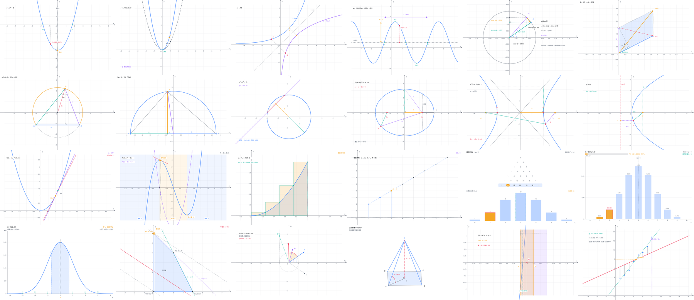

# 高中数学动态实验室 · dsh-math-lab

[](https://github.com/nopanicer/dsh-math-lab/actions/workflows/ci.yml)
[](./LICENSE)
[](./docs/BRIEF.md)

DeepSeek Harness 的**纯客户端**数学可视化插件：侧栏入口「数学实验室」，24 个可调参数的互动模型，
按**高一 / 高二 / 高三**分组，每个模型都有知识点讲解、跟随动画的分步解说、出题判分，
其中立体几何模型还带可拖动的 **3D 视角**。所有图像用解析式在本地计算，不调模型、不耗 token、不联网。



## 安装

从 GitHub 安装（当前发布方式）：

```sh
dsh plugin --profile web add github:nopanicer/dsh-math-lab
```

发布到 npm 之后也可以直接按包名装：`dsh plugin --profile web add dsh-math-lab`。

桌面端：**设置 → 插件 → 添加**，填上面的包名 / Git 地址。
装完重启应用或刷新页面（客户端插件改动需要重新加载）。

> 本地开发：`git clone` 后 `dsh plugin --profile web add link:/绝对路径/dsh-math-lab`，
> 改完 `node build.mjs` 再刷新即可。

## 亮点

- **24 个模型**，参数实时可调，图像、读数与副图同步变化
- **讲解卡片**在右栏：知识点 + 每条分步解说跟随动画进度自动切换
- **练习**：随机出题 / 样例题两种模式（60 道高考风格例题），难度与参数范围匹配，答完给解析；
  答案支持 `3/4`、`√3/2`、`2π/3` 这类写法
- **3D 视角**：立体几何模型拖动画面即可旋转
- **零依赖**：只用 React + Canvas 2D，没有 three.js / 数学库，包体 ~500 KB

## 模型（按备课顺序分组）

### 高一（必修一、二）

| 模型 | 可调参数 | 实时展示 |
|---|---|---|
| 二次函数与判别式 | a、b、c | 顶点、对称轴、Δ、零点、最值、扫描点 |
| 函数图像变换 | 基础函数、a、b、h、k | 原函数与 a·f(b(x−h))+k 的四段连续变形、关键点的像 |
| 指数函数与对数函数 | 底数 a、观察点 x₀ | aˣ 与 log_a x 关于 y = x 镜像、动点与交点 |
| 三角函数图像 | A、ω、φ、k | 周期、振幅、五点法关键点、相位、平衡线 |
| 三角恒等与单位圆 | α、β | sin(α+β) 的几何构成、正余弦投影 |
| 平面向量 | \|a\|、\|b\|（θ 动画扫描） | 平行四边形法则、数量积、投影、\|a ± b\| |
| 解三角形 | 弦 a、顶角 A | 同弦同角、a/sinA = 2R、外接圆与面积 |
| 基本不等式 | a、b | 半圆图解 R ≥ √(ab)、a → b 取等瞬间 |

### 高二（选择性必修一、二）

| 模型 | 可调参数 | 实时展示 |
|---|---|---|
| 直线与圆 | 半径 r、斜率 k | 圆心距 d、弦长、相交/相切/相离 |
| 椭圆 | a、c | r₁ + r₂ = 2a、离心率、通径 |
| 双曲线 | a、c | 渐近线、特征矩形、\|r₁ − r₂\| = 2a |
| 抛物线 | p、开口方向 | 焦点、准线、\|PF\| = 到准线距离 |
| 导数与切线 | 函数、x₀ | 割线随 h → 0 转成切线、切线方程、k(h) 收敛副图 |
| 导数与单调性 | a、b、c | f(x) 与 f′(x) 同屏、单调区间着色、极值 |
| 定积分与面积 | 函数、上限 b | 黎曼和随分割数逼近、误差 – n 双对数副图 |
| 数列与部分和 | 等差/等比、a₁、d 或 r、n | 点列逐项累加、Sₙ 副图（等比含极限线） |

### 高三（选择性必修三 + 一轮）

| 模型 | 可调参数 | 实时展示 |
|---|---|---|
| 排列组合与二项式定理 | n、k | 杨辉三角高亮、C(n,k)、A(n,k)、系数柱、系数和 2ⁿ |
| 二项分布 B(n, p) | n、p、k | 概率柱、E(X)、D(X)、累计概率 |
| 正态分布 N(μ, σ²) | μ、σ、±kσ | 密度曲线、阴影概率、Φ(z)、3σ 对照 |
| 线性规划 | 目标函数 c₁、c₂、最大/最小 | 可行域、平移等值线、最优顶点 |
| 复数与复平面 | 模、辐角（两个复数） | 乘法 = 旋转 + 缩放、共轭、模与辐角 |
| 立体几何：线面角 | 底面边长、高、类型 | 3D 线框、线面角、体积；可拖动旋转 |
| 函数零点与二分法 | 函数、迭代次数 | 区间逐步收缩、误差上界 |
| 统计与一元线性回归 | 噪声、预测点 x₀ | 散点、最小二乘直线、残差平方和 |

每个模型都带：

- **canvas 动画**（播放/暂停、0.25×–2× 变速、重置）
- **开关**：网格、辅助线、3D 视角
- **副图**：随时间变化的量（割线斜率、累计概率、误差、残差平方和、区间精度……）
- **实时读数**与**规律公式 + 教学提示**

### 3D 视角

立体几何模型（正四棱锥 / 正三棱柱）支持 3D：控制条上的「3D 视角」开关打开后，**拖动画面旋转**。
3D 用自写的正交投影（旋转矩阵 + 深度排序）直接画在 2D canvas 上，不引入 three.js。

### 本机记忆

用 localStorage（键 `math-lab/v1`）记住：上次看的模型、每个模型上次的参数、练习得分。

## 开发

```sh
node build.mjs                       # src/ → client.js
node tools/check.mjs                 # 契约检查（24 个模型、讲解、出题、例题、答案解析）
node tools/lint-names.mjs            # 拼接作用域重名检查
node tools/ssr.mjs                   # 用 React 把面板 SSR 渲染一遍（24 模型 × 中英）
node tools/render.mjs --all --sheet  # 无浏览器渲染每个模型，拼一张总览图
```

零依赖，CI（`.github/workflows/ci.yml`）会跑前四项，并检查提交的 `client.js` 是否与 `src/` 同步。

`tools/render.mjs` 把 `model.draw()` 接到 Canvas2D→SVG 记录器，再用 sharp 光栅化，
不开浏览器就能看见画面（主图 `tools/out/<id>.png`、副图 `tools/out/<id>_chart.png`）——
改坐标/布局时先看图再交差。

源码组织：

```
src/core.js              常量、主题、坐标系视图、绘图原语、答案解析、注册表
src/models/<id>.js       一个模型一个文件：defineModel + defineLesson + defineQuiz + defineExams
src/panel.js             面板 UI、渲染循环、练习交互、侧栏注册
```

添加模型只要照 `src/models/quadratic.js` 写一个文件，`node build.mjs` 会自动拼进去。
详细契约见 [`docs/CONTRACT.md`](./docs/CONTRACT.md)，24 个模型的教学意图见 [`docs/BRIEF.md`](./docs/BRIEF.md)。

## 许可

MIT
